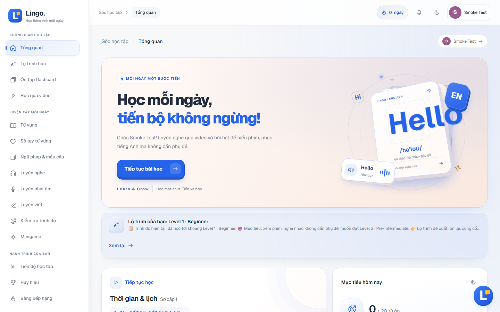
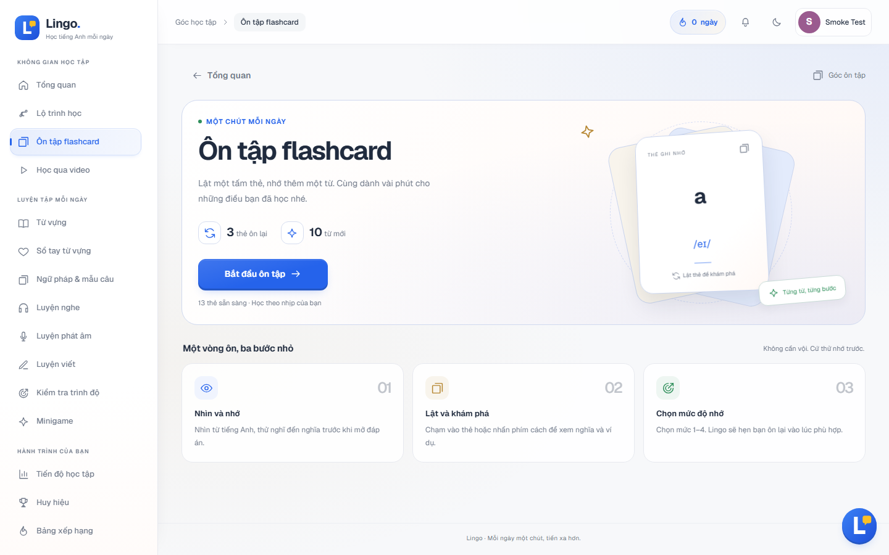
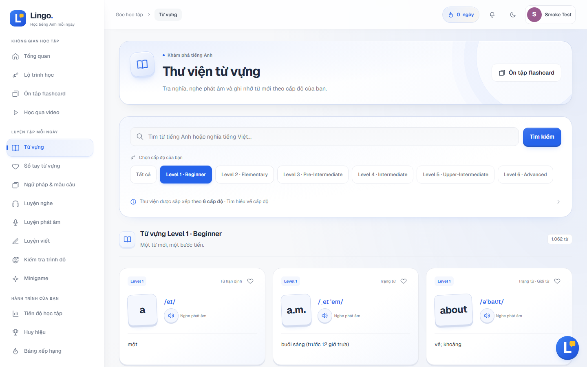
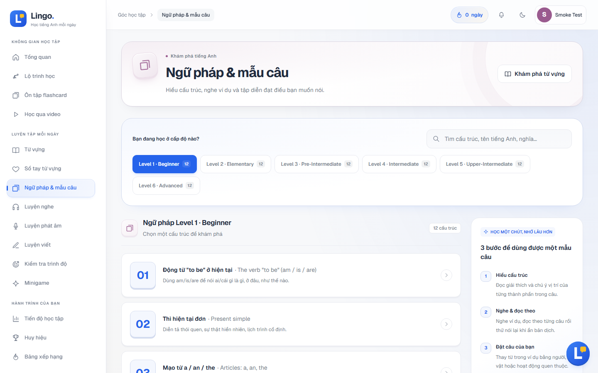
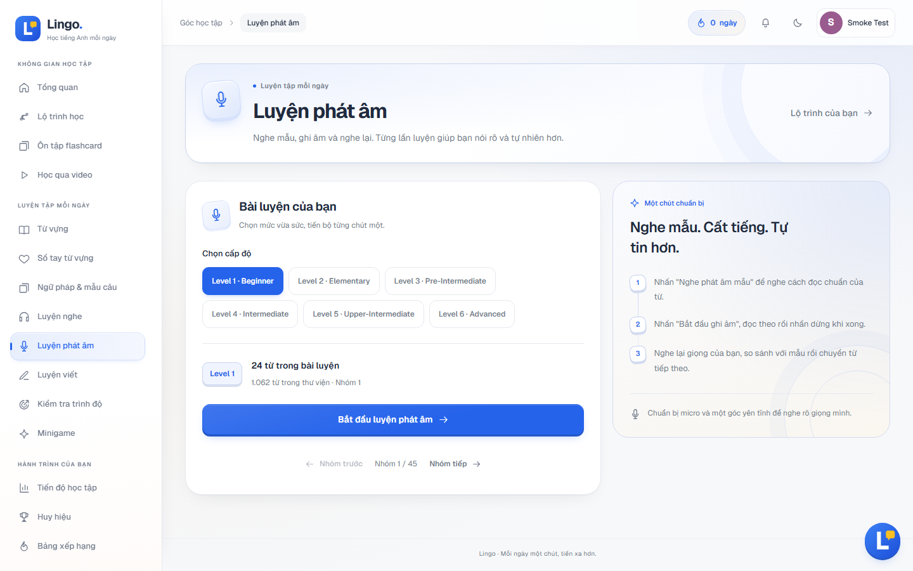
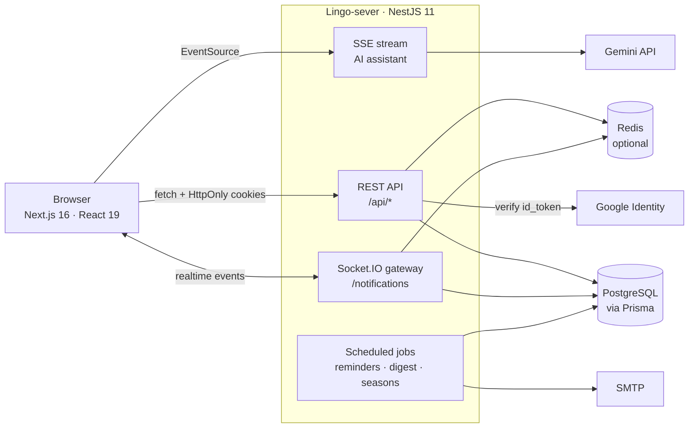

# Lingo — English Learning Platform for Vietnamese Learners

Lingo is a full-stack web app that teaches English to Vietnamese speakers across **6 levels**
(Beginner → Advanced, roughly CEFR A1 → C2). Learners study vocabulary with spaced-repetition
flashcards, follow topic-based lessons, practise listening, dictation and pronunciation, and ask
an AI study assistant when they get stuck.

> This repository is the web client. The API lives in
> [Lingo-sever](https://github.com/Dungnony/Lingo-sever).

## Screenshots

| Dashboard | Flashcard review |
| --- | --- |
|  |  |

| Vocabulary library | Grammar |
| --- | --- |
|  |  |

| Pronunciation practice |
| --- |
|  |

## Features

**Learning**
- 8,600+ words across 6 levels, grouped into 650+ topic-based lessons, each with IPA,
  Vietnamese meaning and an example sentence.
- Spaced-repetition flashcards with two schedulers (SM-2 and FSRS) plus an end-of-session quiz.
- 72 grammar points (12 per level) with explanations and bilingual examples.
- Practice modes: listening, dictation (word-level grading with LCS alignment) and pronunciation
  scoring with the Web Speech API.
- Vocabulary notebook: save words with ♥, review "difficult" words, and quiz yourself on them.
- Learn from YouTube videos: English captions are fetched automatically and machine-translated
  into Vietnamese.
- Placement survey that recommends a starting level and a study plan.

**AI study assistant**
- RAG over grammar points and FAQ using the Gemini API, with per-user context (streak, lessons
  in progress, recent practice).
- Answers stream token by token over Server-Sent Events, with multiple chat sessions.
- Tool calling to suggest pages or videos, and a daily limit of 30 questions per user.

**Engagement**
- Streaks (timezone-aware), daily goals, achievements and leaderboards.
- Mini-games and real-time 1v1 duels with ELO ranking and monthly seasons.
- Follow other learners, 1-1 real-time messaging, and in-app notifications over WebSockets.
- Web Push study reminders and a weekly email digest; installable as a PWA.

**Accounts and admin**
- Email/password sign-up with email verification, Google sign-in, password reset.
- JWT access + rotating refresh tokens stored in HttpOnly cookies.
- Role-protected admin panel to edit words, grammar points and videos.

## Architecture



- **Client** (`Lingo-client`, this repo): Next.js App Router, SWR for data fetching, auth state
  in React Context, every request goes through `lib/api.ts`, which retries once after refreshing
  an expired token.
- **Server** (`Lingo-sever`): one NestJS module per domain (auth, vocabulary, srs, grammar,
  practice, notebook, assistant, admin, …). Input is validated with `class-validator`,
  environment variables with `zod` at startup, and a global JWT guard protects every route
  unless it is marked `@Public()`.
- **Data pipeline** (`Lingo-sever/scripts/import`): downloads CEFR word lists, uses Gemini to
  add IPA, Vietnamese meanings and examples (resumable, cached), then builds the seed file.

## Tech stack

| Layer | Technologies |
| --- | --- |
| Frontend | Next.js 16, React 19, TypeScript, Tailwind CSS v4, SWR, socket.io-client |
| Backend | Node.js 22, NestJS 11, Socket.IO, class-validator, zod, Swagger |
| Database | PostgreSQL, Prisma 7 (node-postgres driver adapter), Redis (optional) |
| AI & integrations | Gemini API (`@google/genai`), Google Identity Services, Web Speech API, Web Push, Nodemailer |
| Testing | Jest (server), Node test runner (client) |

## Getting started

### Prerequisites

- Node.js 22
- PostgreSQL (developed on 16), or Docker using `Lingo-sever/docker-compose.yml`
- Optional: Redis, a [Gemini API key](https://aistudio.google.com/apikey) for word data and the
  AI assistant, a Google OAuth client ID for Google sign-in

### 1. Server

```bash
git clone https://github.com/Dungnony/Lingo-sever.git
cd Lingo-sever
cp .env.example .env          # set DATABASE_URL and the two JWT secrets
docker compose up -d          # optional: Postgres on port 2222, Redis on port 2223
npm install
npx prisma generate           # builds the Prisma client into src/generated (also run by build/test/start:dev)
npx prisma migrate deploy
npm run db:seed
npm run start:dev             # http://localhost:8000/api
```

API docs (Swagger) are served at `http://localhost:8000/api/docs` in development, and a
health check at `GET /api/health`.

Docker is optional: point `DATABASE_URL` at any running PostgreSQL. Without Redis, WebSockets
run in single-instance mode and log a warning instead of crashing.

### 2. Client

```bash
git clone https://github.com/Dungnony/Lingo-client.git
cd Lingo-client
cp .env.example .env.local    # NEXT_PUBLIC_API_URL=http://localhost:8000/api
npm install
npm run dev                   # http://localhost:3000
```

### 3. Optional: admin access

```bash
cd Lingo-sever
npm run user:set-role -- you@example.com admin
```

### Vocabulary data

Words ship with the seed. To rebuild them from the source word lists (needs `GEMINI_API_KEY`):

```bash
cd Lingo-sever
npm run data:fetch-sources
npm run data:enrich-words     # resumable; results are cached
npm run data:build-words
SEED_RESET=true npm run db:seed
```

Without `GEMINI_API_KEY`, the AI assistant reports that it is disabled; the rest of the app keeps
working. `data:enrich-words` only processes words that are still missing, so it can be re-run
after the free Gemini quota resets. Details: `Lingo-sever/scripts/import/README.md`.

> **Seeding and admin edits.** `npm run db:seed` only creates missing grammar points, so edits
> made in `/admin` are kept; `SEED_GRAMMAR_OVERWRITE=true` rewrites them from the seed file.
> `SEED_RESET=true` deletes every word, which also removes saved notebook words, review progress,
> learner reports, review status and any vocabulary edits made in `/admin`.

### Installable app (PWA)

The client ships a manifest and a service worker that only caches an offline screen. The service
worker registers in production builds served over HTTPS or localhost (`npm run build && npm
start`). See [docs/pwa.md](docs/pwa.md).

## Scripts

| Where | Command | What it does |
| --- | --- | --- |
| server | `npm run start:dev` | Start the API in watch mode |
| server | `npm test` | Run Jest unit tests |
| server | `npm run test:e2e` | Smoke tests (needs PostgreSQL + Redis) |
| server | `npx prisma generate` | Generate the Prisma client into `src/generated` |
| server | `npx prisma migrate deploy` | Apply database migrations |
| server | `npm run db:seed` | Seed levels, achievements, words, lessons, grammar |
| server | `npm run lint` | ESLint + Prettier (auto-fix) |
| server | `npm run build` | Compile to `dist/` |
| client | `npm run dev` | Start the Next.js dev server |
| client | `npm test` | Run Node test-runner tests |
| client | `npm run lint` | ESLint |
| client | `npm run build` | Production build |

## Project structure

```
Lingo-sever/
  src/modules/      one NestJS module per domain
  src/common/       decorators, guards, filters, level constants
  prisma/           schema, migrations, seed data
  scripts/import/   vocabulary ETL pipeline (CEFR lists + Gemini)
Lingo-client/
  app/              Next.js App Router pages
  components/       UI components
  lib/              API client, hooks, pure helpers (unit-tested)
  tests/            Node test-runner tests
```

## Technical decisions

- **Levels:** 6 levels mapped from CEFR (A1 → 1 … C2 → 6). Level constants live only in
  `Lingo-sever/src/common/levels.ts` and its client counterpart `lib/levels.ts`.
- **Spaced repetition:** SM-2 by default; FSRS can be selected per user. Progress rows store the
  fields of both, so switching needs no migration.
- **Auth:** HttpOnly cookies (`lingo_access`, `lingo_refresh`); refresh tokens rotate and token
  reuse is detected per token family.
- **Stateless server disk:** uploaded avatars and the assistant's embedding index are stored in
  PostgreSQL, not on the filesystem, so the API runs on hosts with an ephemeral disk (such as
  free tiers) without losing images or re-embedding on every restart.
- **Cold starts:** free hosting tiers put the API to sleep when idle, so the first request can
  take up to a minute. After 5 seconds the loading screen explains the wait instead of showing
  a spinner that looks broken.
- **Audio:** there are no recorded audio files; pronunciation uses the browser's English
  text-to-speech voice.
- **AI-generated content:** IPA, Vietnamese meanings and example sentences were generated by
  Gemini and have not been fully reviewed by hand, so some may be wrong. Learners can flag a
  wrong word (🚩 next to ♥); `npm run data:check-words` (server) has Gemini proofread the
  words and flags the doubtful ones; admins work through unreviewed, reported and AI-flagged
  words in `/admin` (one by one or a page at a time). The AI never approves a word itself.

## Data sources

Word lists come from CEFR-J 1.5 (A1–B2) and Octanove C1/C2, licensed CC BY-SA 4.0. See
`Lingo-sever/data/NOTICES.md` for attribution.
